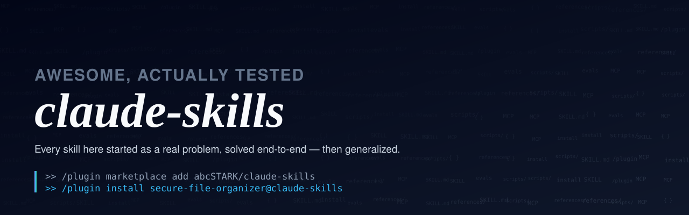
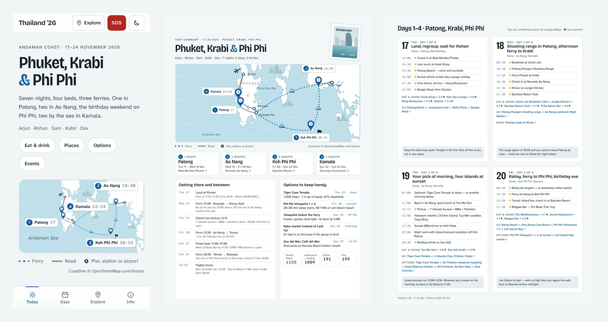

<div align="center">

</div>

Every skill in this repo started as an actual multi-hour session solving a real problem, then got generalized into something reusable. Nothing here was written speculatively; if a skill says "watch out for X," it's because X actually happened and cost someone time to debug.

---

## Install

This repo is a Claude Code plugin marketplace. Add it once, then install whichever skills you want:

```
/plugin marketplace add abcSTARK/claude-skills
/plugin install secure-file-organizer@claude-skills
/plugin install travel-itinerary-builder@claude-skills
```

That's it — the skills are now available in any Claude Code session.

---

## Skills

| Skill | What it does |
|---|---|
| [`travel-itinerary-builder`](plugins/travel-itinerary-builder) | Plans a multi-day trip from your bookings and wish-list, verifies every place, and generates a phone-first live trip guide (illustrated route map from real coastline, Now/Next, day plans, options, vetted food and bars), a shareable A4 PDF with working links, and PNG pages for WhatsApp. |
| [`secure-file-organizer`](plugins/secure-file-organizer) | Organizes a messy filesystem into a clean category structure, detects sensitive personal documents by reading file *content* (not just filenames), and routes them into a macOS encrypted vault it creates and maintains. Also handles deeper domain-specific splits (study material by subject, resumes by year, travel docs by trip). |

More skills will land here over time — same bar: field-tested first, generalized second.

---

## secure-file-organizer, in more detail

### The problem it solves

A typical "organize my Downloads folder" request isn't really a file-sorting problem — it's a judgment problem wearing a file-sorting costume. The files that are easy to categorize (movies, installers, obviously-named documents) aren't the ones that matter. The ones that matter are:

- A PDF named `Unknown-3.pdf` or `scan.12306061442000.pdf` that turns out to be a government ID or someone's academic transcript.
- Two files with the same name in different folders that *look* like duplicates but aren't — a draft vs. a final version.
- An old installer that's genuinely safe to delete vs. one that's actually a rare build you can't easily re-download.
- A filename with an accented character that mysteriously "doesn't exist" when you try to move it (it's a macOS Unicode normalization quirk, not a missing file).

This skill encodes the judgment calls, not just the mechanical sorting.

### What makes it different from "just move files by extension"

- **Reads content to detect PII, not just filenames.** Generic or misleading filenames are exactly where sensitive documents hide. The skill treats ambiguous files as worth opening, not worth guessing about.
- **Creates and maintains a real encrypted vault** (macOS `hdiutil`/sparsebundle), with a hard rule that the agent never sees or types the vault password — the user sets it through the native system dialog.
- **Only deduplicates on cryptographic proof.** Same name, same size, same vibe — none of that is enough. Only a matching checksum gets a file deleted as a duplicate, and even then, only after being shown to the user for anything beyond a few obviously-safe cases.
- **Confirms before anything destructive**, and explains its reasoning when it does.
- **Ships a deterministic dedup scanner** (`scripts/find_duplicates.py`) instead of re-deriving ad hoc `shasum` loops every time.

### Example

> "My Downloads folder is a disaster — movies, random PDFs, some ID scans, duplicate installers everywhere. Can you sort it out?"

The skill will: survey what's actually there, propose a category structure before moving hundreds of files, open ambiguous documents to check for sensitive content, stand up an encrypted vault for anything sensitive it finds, remove only checksum-confirmed duplicates, and hand back a clear summary of what moved where — plus a flagged list of anything it wasn't confident enough to decide on its own.

---

## travel-itinerary-builder, in more detail



### The problem it solves

A group trip plan usually lives in five places: a spreadsheet, a WhatsApp thread, screenshots of YouTube recommendations, booking emails and someone's memory. On the road nobody can answer "where are we eating tonight, and how far is it?" without scrolling for ten minutes. And most AI-made itineraries are confident lists of places that closed last year.

### What it does differently

- **Verifies before it plans.** Every place on your list is checked for existence, opening hours on that weekday and rating, and corrected or flagged; every place it adds has to clear Google 4.5+ and be a proper venue. Entry rules, ferry slots, check-in times and weekend-only markets are looked up for your dates.
- **One data file, three outputs.** The agent writes a `trip.json`; a bundled script (`itinerary_kit.py`) renders the live HTML guide, the PDF and the PNGs from it, so every correction lands everywhere at once.
- **Built for use on the street.** Light, high-contrast and legible in sun; glass top and bottom bars that always show the day you're in; Now/Next during the trip; options for every flexible slot shown as swipeable cards; an Explore shortcut to food, places, options and events by area; an SOS button.
- **A real map, not a chart.** Coastline is clipped from OpenStreetMap-derived land polygons for your area and drawn as an illustrated route map with numbered pins and ferry/road/rail legs.
- **Checks its own work.** `itinerary_kit.py check` audits the page at phone and desktop widths (overflow, font sizes, tap targets, JS errors) and `render` reports any PDF card that doesn't fit and how many links the PDF has.

### Example

> "Five of us are doing Phuket, Krabi and Phi Phi from the 17th. Flights and hotels are booked, one friend lands at 8 pm on day one and it's his birthday on the 21st. Here's our YouTube list. Make something I can open on my phone during the trip, and a PDF for the group chat."

Try the bundled example (needs `pip install playwright pypdf` for the PDF/PNG step):

```
cd plugins/travel-itinerary-builder/skills/travel-itinerary-builder
python3 scripts/itinerary_kit.py all examples/andaman-trip.json --out /tmp/andaman
```

---

## Repo structure

```
claude-skills/
├── .claude-plugin/
│   └── marketplace.json          # marketplace manifest — lists every plugin below
└── plugins/
    ├── travel-itinerary-builder/
    │   ├── .claude-plugin/plugin.json
    │   └── skills/travel-itinerary-builder/
    │       ├── SKILL.md                      # workflow, planning rules, design system, lessons
    │       ├── scripts/
    │       │   ├── itinerary_kit.py          # trip.json -> HTML guide, PDF, PNGs, layout audit
    │       │   └── fetch_coastline.py        # clips real coastline for the route map
    │       ├── references/trip-schema.md     # every trip.json field
    │       ├── examples/                     # a complete 8-day trip + its coastline
    │       └── evals/evals.json
    └── secure-file-organizer/
        ├── .claude-plugin/
        │   └── plugin.json
        └── skills/
            └── secure-file-organizer/
                ├── SKILL.md                      # the skill itself
                ├── references/                   # docs loaded in as needed
                │   └── encrypted-vault-guide.md
                ├── scripts/                       # deterministic helper code
                │   └── find_duplicates.py
                └── evals/                          # test cases used to validate it
                    └── evals.json
```

Each future skill gets its own `plugins/<skill-name>/` directory following the same shape.

---

## Contributing / adding a new skill

1. Create `plugins/<name>/.claude-plugin/plugin.json` and `plugins/<name>/skills/<name>/SKILL.md`.
2. Add an entry to `.claude-plugin/marketplace.json`.
3. Write it from a real problem, not a hypothetical — if you haven't hit the edge case yet, you probably don't know the right instruction for it yet either.
4. Test it with realistic prompts before merging — the `evals/` folder convention in `secure-file-organizer` is a reasonable template to follow.

---

## License

[MIT](LICENSE)
